# CRTC2026 中期考核文档 · 怀瑾战队

| 项目 | 内容 |
| --- | --- |
| 队伍名称 | 怀瑾战队 |
| 参赛组别 | 新生组 |
| 队长 | 周万政 |
| 队员 | 陈舒莹 陆景颐 屈筠青 叶绍杰 |
| 实训战队 | ConQU 实训战队 |
| 文档提交日期 | 2026 年 10 月 19 日 |


## 0. 项目概况

### 0.1 赛题理解与设计目标

CRTC2026 的核心形式是机器人之间的资源争夺：双方在 2400mm×2400mm 的场地内，于 5 分钟一局的时间内尽可能多地收集与携带道具（能量单元 / 能量核心），结束时持有道具分数高者获胜。场地包含高台（+300mm）、台阶（+150mm）、坡道（坡比 0.5）、桥梁与物资架等要素。

针对上述赛题，本队的中期设计目标是：

1. 采用**四轮麦克纳姆轮底盘**，实现前后、左右、原地旋转三自由度全向移动，以便在狭窄地形与对峙中保持机动性；
2. 采用赛题官方指定的 **PS2 无线手柄**遥控，保证与检录要求一致；
3. 底盘具备爬坡与压台阶的通过性，并为后续的**携带机构（舵机夹爪/托举）**预留安装位与供电余量；
4. 全程遵守技术规范：单供电模块、额定电压 ≤ 7.4V、初始尺寸 ≤ 290×195×210mm、重量 ≤ 2.0kg、适配官方无线继电器。

### 0.2 机器人技术参数

| 参数项 | 设计值 / 实测值 | 规则上限 |
| --- | --- | --- |
| 主控 | STM32F103C8T6 核心板 | — |
| 底盘形式 | 四轮麦克纳姆轮（60mm 黄色麦轮） | — |
| 驱动 | DRV8833 × 2 + TT 马达（单轴 1:48）× 4 | — |
| 供电 | 18650 电池盒（2 节，7.4V）+ DC-DC 降压 5V | ≤ 7.4V，每台仅 1 个供电模块 |
| 通信 | PS2 无线手柄 + 直插转接板（软件模拟 SPI） | 2.4G 无线 |
| 初始尺寸（长×宽×高） | **280 × 170 × 205 mm** | ≤ 290×195×210mm（符合） |
| 展开尺寸（长） | **391 × 170 × 205 mm** | ≤ 445mm（符合） |
| 重量 | **1.8 kg** | ≤ 2.0kg |
| 整车造价 | **¥600.00** | 新生组建议 ≤ ¥400.00 |

### 0.3 总体方案

**供电链路**：18650（7.4V）→ 无线继电器 → 底盘总电源 → 分两路：一路直供 DRV8833 的 VM（7.4V，驱动 TT 马达）；一路经 DC-DC 降压至 5V，供给 STM32 核心板、PS2 接收器与舵机。

**控制链路**：PS2 手柄 →（2.4G）→ 接收器 →（软件模拟 SPI）→ STM32 → 麦克纳姆逆解 → PWM + 方向电平 → DRV8833 → TT 马达。

**关键设计决策一览**：

| 决策点 | 选择 | 理由 |
| --- | --- | --- |
| 遥控方案 | 官方 PS2 手柄 | 规则指定；按键多、摇杆精度满足需求 |
| 通信方式 | 软件模拟 SPI | 引脚灵活、便于调试，PS2 速率低无性能压力 |
| 轮系 | 麦克纳姆轮 | 需要横向平移与原地旋转 |
| 走线 | 由面包板 → 洞洞板/PCB | 规则建议集成电路板，杜邦线易脱落 |
| 舵机供电 | 电源端并联 2200μF 电解电容 | 抑制舵机堵转瞬间的电压跌落 |

**硬件总体架构**（橙色为 7.4V 动力电，金色为 5V 控制电，蓝色为信号线；各模块已用实物图标注，引脚分配见附录 A）：
（请点击此处查看照片）
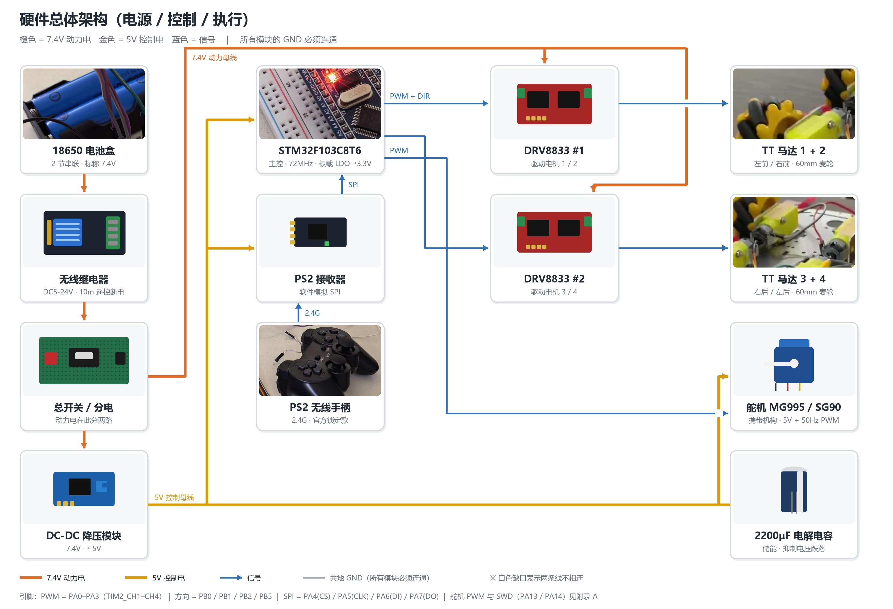

*图 1　硬件总体架构：电源 / 控制 / 执行三段式，颜色区分电压等级与信号*


---

## 1. 底盘机械结构与麦轮安装（10.6～10.8）

### 1.1 功能描述

完成四轮麦克纳姆底盘的机械装配，保证四个麦轮辊子呈正确的对置关系，使底盘能够实现前后、左右、原地旋转三种运动。对应考核指标：**外形展示**、**尺寸规范**、结构稳定性。

### 1.2 设计思路与选型

底盘采用官方物资表中的**四轮金属折弯底盘（一体带马达孔）**，配合 60mm 黄色麦轮（一套 4 个，含 TT 马达联轴器）。四个麦轮的编号与位置约定为：

- 1 = 左前（FL）
- 2 = 右前（FR）
- 3 = 右后（RR）
- 4 = 左后（RL）

**麦轮安装的辊子朝向是本项目最容易出错的地方。** 正确安装要求：俯视整车时，四个麦轮的辊子走向整体呈 **X 形**——即**左前轮与右后轮的辊子朝向一致，右前轮与左后轮的辊子朝向一致**，左右两侧互为镜像。只有满足这一对置关系，四个轮子的横向分力才能在左右平移时同向叠加、在前后运动时相互抵消。

### 1.3 开发历程

- **10.6**：队员集合，拆封收到的快递，清点零件齐全度，完成底盘的初步拼装。
- **10.7**：完成底盘机械部分的拼装，转入电控部分。
- **10.8**：在底盘运动调试中发现麦轮安装存在错误（详见 1.4），调整辊子朝向后解决；同日并行推进第二台小车的装配。

### 1.4 问题与解决

**问题 1：底盘附赠螺丝数量不足、规格不符。**

自购螺丝因长度不足，无法将轮座与底盘主板可靠固定。

> 解决：本地（重庆）未能找到合适型号，由组内其他成员在外地采购，并于国庆假期结束时带回，最终完成固定。

**问题 2：麦轮辊子朝向装反，底盘无法横向平移。**

最初装配时未留意车头方向，也没有区分麦轮的安装方法，四个轮子按**同一朝向**安装。其后果是：前后运动正常，但左右平移时两侧横向分力相互抵消，底盘无法按标准平移。

> 解决：放弃从代码层面继续排查，转而回到硬件装配本身。按 X 形对置关系重新安装（左前与右后同向、右前与左后同向，左右镜像），问题解决。**教训：全向轮系的故障优先怀疑安装朝向，而不是先怀疑算法。**

**问题 3：走线可靠性。**

面包板 + 杜邦线的连接方式在整车运动时存在脱落风险。

> 进展：**10.12** 起尝试以**洞洞板（万用板）**替代面包板，把电源与驱动部分的走线焊接到板上；后续计划进一步制作 PCB。这与规则中「线路设计建议采用集成电路板方式」的要求一致。
（请点击此处查看照片）
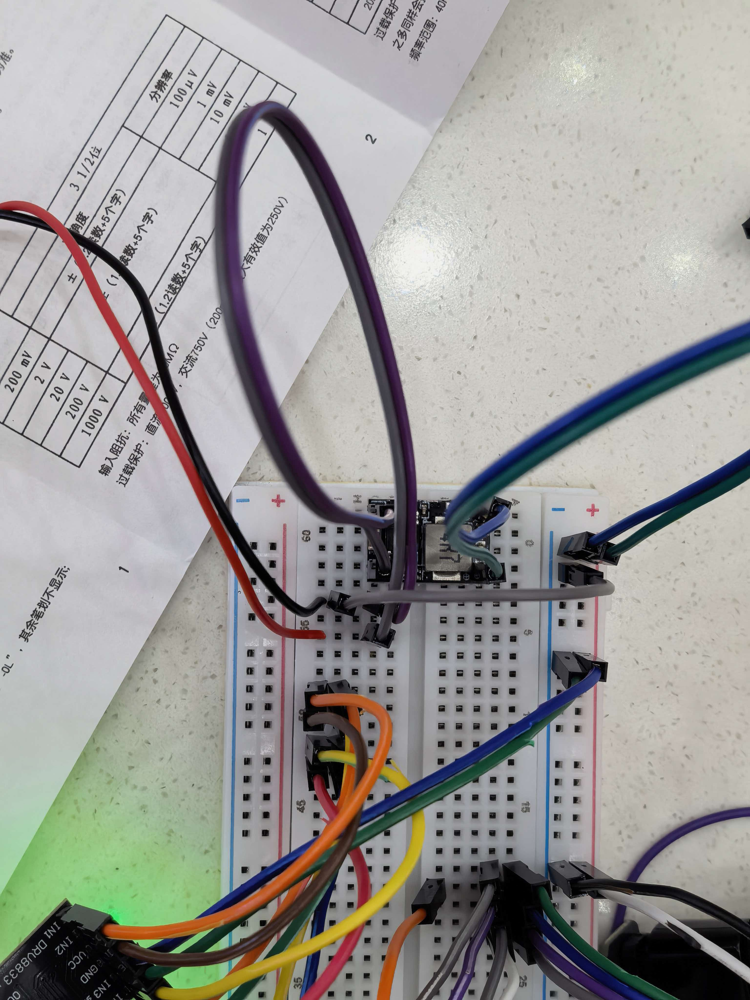

*图 2　早期面包板实验：以面包板承载主控、DRV8833 与信号连线*
（请点击此处查看照片）
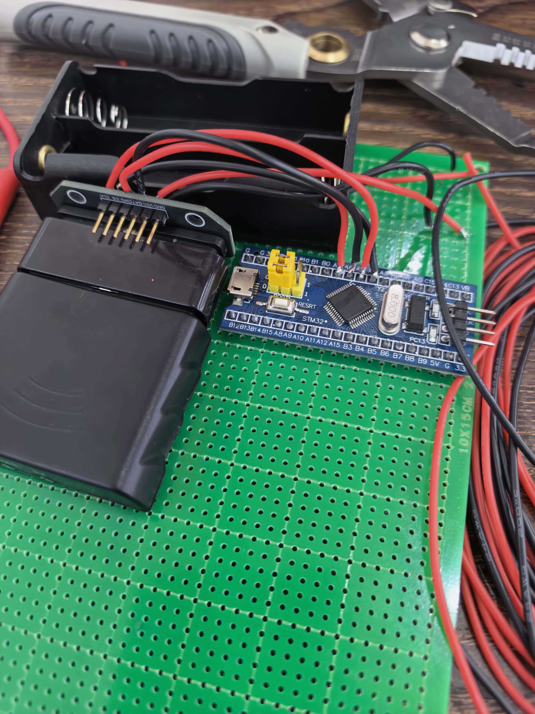

*图 3　改用洞洞板（万用板）焊接走线，降低杜邦线脱落风险*

### 1.5 当前状态与待办

- 底盘机械装配：**已基本完成**，两辆车均已完成拼装。
- 麦轮朝向：已按 X 形对置修正，实车平移测试见第 5 节视频 5-1、5-2。
- 尺寸/重量：尚未实测，需按规则要求用直尺等工具拍摄测量结果（对应「尺寸规范」指标）。
- 走线：由面包板迁移至洞洞板/PCB 的工作进行中。

---

## 2. 供电系统与电源管理（10.7～10.12）

### 2.1 功能描述

为整车提供稳定、安全、符合规范的供电：18650 电池经无线继电器接入底盘，再由 DC-DC 降压模块为控制与执行单元供电；保证各模块共地，并抑制舵机动作时的电压波动。

### 2.2 设计思路与选型

| 电路 | 电压 | 供给对象 |
| --- | --- | --- |
| 电池直供 | 7.4V | DRV8833 的 VM（TT 马达） |
| DC-DC 降压 | 5V | STM32 核心板、PS2 接收器、舵机 |
| 核心板 LDO | 3.3V | STM32 芯片、PS2 接收器逻辑电平 |

设计要点：

1. **单供电模块**：按规则，每台机器人仅允许 1 个供电模块且额定电压不超过 7.4V，因此采用 2 节 18650 串联（标称 7.4V），并由 DC-DC 完成电压分配。
2. **共地**：STM32、DRV8833、PS2 接收器、DC-DC 的 GND 必须连在一起，否则 PWM/SPI 信号无参考电平。
3. **无线继电器（规则强制）**：按手册要求，机器人必须适配官方指定无线继电器，使底盘电源可在 10m 范围内被独立遥控器切断，检录时需现场演示该断电功能。
4. **储能电容**：在 5V 电源端（舵机供电处）并联 **2200μF 电解电容**，作为储能与滤波元件，吸收舵机启动/堵转瞬间的冲击电流，抑制母线电压跌落。

### 2.3 开发历程

- **10.7**：首次连接导线时发生接错，正负极接反，导致 1 个 DC-DC 降压模块烧毁；改正接线方式后再未出现同类问题。
- **10.9**：在培训与学长指导的启发下，于面包板上加入 2200μF 电解电容，舵机转动时的电压电流明显趋于稳定。
- **10.12**：尝试以洞洞板替代面包板，提升供电与驱动走线的可靠性。
（请点击此处查看照片）
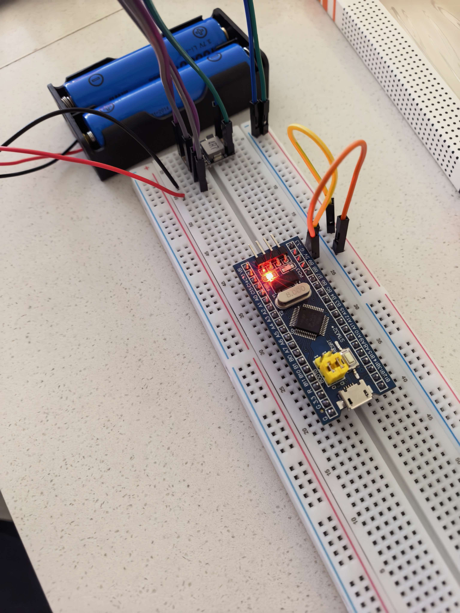

*图 4　供电链路打通：18650 电池经 DC-DC 降压后，主控电源指示灯点亮*

### 2.4 问题与解决

**问题：正负极接反烧毁 DC-DC 模块。**

现象：上电后降压模块无输出并发热损坏。

排查：对照接线图逐段核对，确认电池正负极在进入 DC-DC 输入时被接反。

解决：更正接线；并在之后每次上电前先断电核对极性。**改进措施：统一线序与插头（如统一使用 XT30），并在电源入口标注正负极颜色，从物理上避免再次接反。**

### 2.5 当前状态与待办

- 供电链路：已跑通并稳定运行（舵机加电容后）。
- 无线继电器：尚未采购与适配，需在通过中期考核后按规则采购并完成 10m 断电演示。
---

## 3. PS2 无线手柄通信（软件模拟 SPI）

### 3.1 功能描述

由 STM32 通过软件模拟 SPI 与 PS2 手柄接收器通信，周期性读取摇杆与按键数据，作为底盘运动控制的输入。对应考核指标：**底盘运动（单一 / 全部）**。

### 3.2 设计思路与选型（10.7～10.8）

**为什么不使用硬件 SPI？** STM32 的硬件 SPI 需占用固定引脚且配置繁琐；PS2 通信速率不高（手柄更新率约 50Hz），软件模拟 SPI 完全够用，且引脚可自由指定，便于布线与调试。

**引脚分配**：

| 信号 | 方向 | STM32 引脚 |
| --- | --- | --- |
| CS（片选） | STM32 → 接收器 | PA4 |
| CLK（时钟） | STM32 → 接收器 | PA5 |
| DI（数据输入到接收器） | STM32 → 接收器 | PA6 |
| DO（数据输出到 STM32） | 接收器 → STM32 | PA7 |

> ⚠️ DI/DO 最容易接反：DI 是「接收器输入」，应接 STM32 的输出脚；DO 是「接收器输出」，应接 STM32 的输入脚（PA7 配置为浮空输入）。

**通信时序**：主机拉低 CS 开始通信；每周期传输 1 bit，主机在时钟下降沿更新 DI，从机在上升沿更新 DO；主机在上升沿采样 DO。传输 9 个字节后拉高 CS 结束。

**数据帧**（发送 9 字节 / 同时接收 9 字节）：

| 字节 | 发送 | 接收 | 含义 |
| --- | --- | --- | --- |
| 0 | 0x01 | 0xFF | 起始 |
| 1 | 0x42 | 0x41 / 0x73 | 请求数据（0x41 数字模式 / 0x73 模拟模式） |
| 2 | 0x00 | 0x5A | 恒为 0x5A |
| 3 | 0x00 | 按键数据 1 | 0 表示按下 |
| 4 | 0x00 | 按键数据 2 | 0 表示按下 |
| 5 | 0x00 | 右摇杆 X | 0x00–0xFF |
| 6 | 0x00 | 右摇杆 Y | 0x00–0xFF |
| 7 | 0x00 | 左摇杆 X | 0x00–0xFF |
| 8 | 0x00 | 左摇杆 Y | 0x00–0xFF |

摇杆值中心约 0x80，代码中统一减去 128，得到 −128~127 的范围，便于映射到电机速度。

### 3.3 开发历程

- **10.7**：出现两个问题——① 手柄一开始无法与接收器配对；② 配对成功后接收器仍无法与手柄建立数据关联，信号传不过去。
- **10.8**：烧录商家提供的 `.hex` 文件，确认对本接线方案无效；后经查阅资料定位到问题方向（见 3.4），调整后手柄与接收器通信打通。
- 同日：在第二台小车上复现接线与调试流程，这一次连接异常顺利，说明问题已定位。
（请点击此处查看照片）
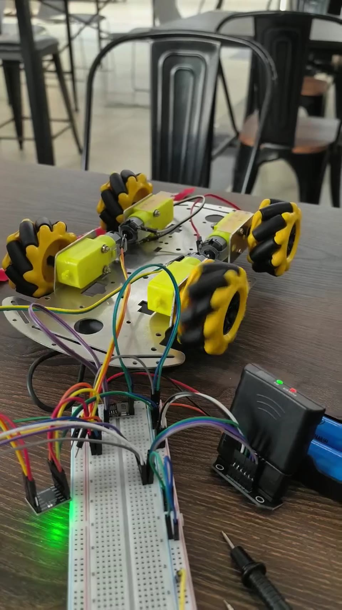

*视频 3-1　车体与 PS2 手柄同时出镜，手柄控制单个电机转动（完整视频：手柄控制电机旋转（单个）.mp4）*

### 3.4 问题与解决

**问题 1：手柄无法与接收器配对。**

解决：经商家提示，**PS2 接收板背面有一个配对/锁定按键，需要长按以解除锁定**。这与官方物资表说明一致——官方提供的 PS2 手柄为「可对频锁定款」，需先解锁才能正常对频。

**问题 2：配对后仍无数据（信号无法传递）。**

过程：先尝试烧录商家提供的启动 `.hex` 文件，确认无效（该文件与当前接线/固件组合不匹配）；随后查阅资料，判断为**主机轮询接收器的节奏过快**——即软件 SPI 的位延时（`PS2_Delay()`）过短、两次读取之间的间隔过小，导致接收器来不及响应。

解决：**放慢询问频率**——增大软件 SPI 的位延时，并把主循环读取间隔调整到与手柄刷新率匹配的节奏（约 50Hz，主循环 `HAL_Delay(20)`），手柄与接收器最终通信畅通。

> **经验**：PS2 接收器对时序较为敏感，位延时宁可先取大一些，确认能通后再逐步收紧。

### 3.5 当前状态与待办

- 通信：**已打通**，可稳定读取摇杆与按键。
- 已提供：车体与手柄同时出镜的遥控演示见 3.3 视频 3-1。
- 待补充：按键测试与摇杆死区实测数据。

---

## 4. 电机驱动与 PWM 调速

### 4.1 功能描述

驱动 4 个 TT 马达正反转并调速。对应考核指标：**电机运动（单一）**与**电机运动（全部）**。

### 4.2 设计思路与选型

- **驱动方案**：DRV8833 为双 H 桥，单片可驱动 2 个电机，因此 4 个电机使用 2 片 DRV8833。
- **调速原理**：TT 马达转速与平均电压近似成正比，通过 PWM 改变平均电压实现调速。
- **PWM 配置**：TIM2，PSC = 71，ARR = 999，定时器时钟 72MHz，则
  `f = 72MHz / (71+1) / (999+1) = 1kHz`；
  选择 1kHz 是因为：频率过低电机会有啸叫噪音，过高则开关损耗与发热增加，1kHz 是兼顾噪音与效率的常用值。
- **死区**：电机在极小占空比下可能不转但仍发热，设置 ±50 的死区，避免摇杆中位附近的抖动。

**引脚分配**：

| 功能 | 引脚 | 外设 |
| --- | --- | --- |
| 电机 1 PWM | PA0 | TIM2_CH1 |
| 电机 2 PWM | PA1 | TIM2_CH2 |
| 电机 3 PWM | PA2 | TIM2_CH3 |
| 电机 4 PWM | PA3 | TIM2_CH4 |
| 电机 1 方向 | PB0 | GPIO 输出 |
| 电机 2 方向 | PB1 | GPIO 输出 |
| 电机 3 方向 | PB2 | GPIO 输出 |
| 电机 4 方向 | PB5 | GPIO 输出 |

> 方向脚刻意避开 PB3/PB4，以免与 JTAG 复用引脚冲突。

**核心代码**：

```c
void Motor_SetSpeed(int motor_id, int speed) {
    /* 限幅与死区 */
    if (speed >  1000) speed =  1000;
    if (speed < -1000) speed = -1000;
    if (speed > -50 && speed < 50) speed = 0;

    int pwm = (speed >= 0) ? speed : -speed;
    GPIO_PinState dir = (speed >= 0) ? GPIO_PIN_RESET : GPIO_PIN_SET;

    switch (motor_id) {
        case 1:
            HAL_GPIO_WritePin(GPIOB, GPIO_PIN_0, dir);
            __HAL_TIM_SET_COMPARE(&htim2, TIM_CHANNEL_1, pwm);
            break;
        /* 电机 2/3/4 同理 */
    }
}
```

### 4.3 开发历程

- **10.7**：连接电机驱动部分，完成 DRV8833 与 TT 马达的接线（其间发生电源反接事故，见第 2 节）。
- **10.8**：底盘运动调试中发现麦轮方向问题（详见第 5 节），电机驱动本身工作正常。
- 10.9：完成单电机正反转与 PWM 调速实测，逐个核对电机编号对应关系（见视频 4-1～4-3）。
（请点击此处查看照片）
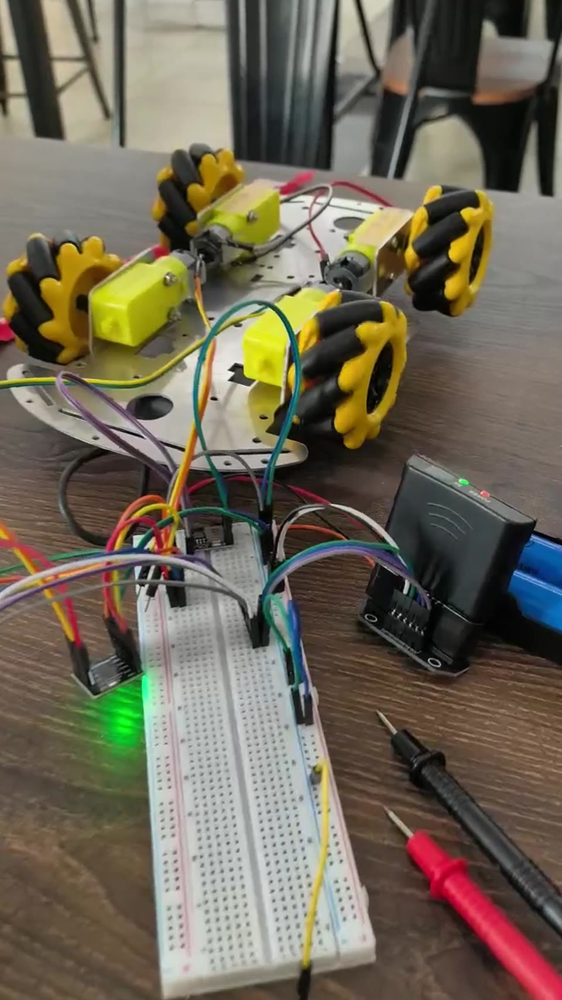

*视频 4-1　单个电机通电慢转（对应「电机运动（单一）」）（完整视频：电机通电慢转（单个）.mp4）*
（请点击此处查看照片）
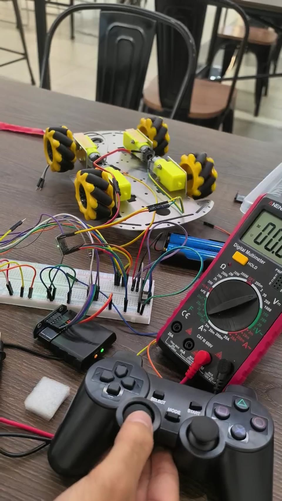

*视频 4-2　手柄控制一组（2 个）电机同时转动（完整视频：手柄控制电机旋转（一组）.mp4）*
（请点击此处查看照片）
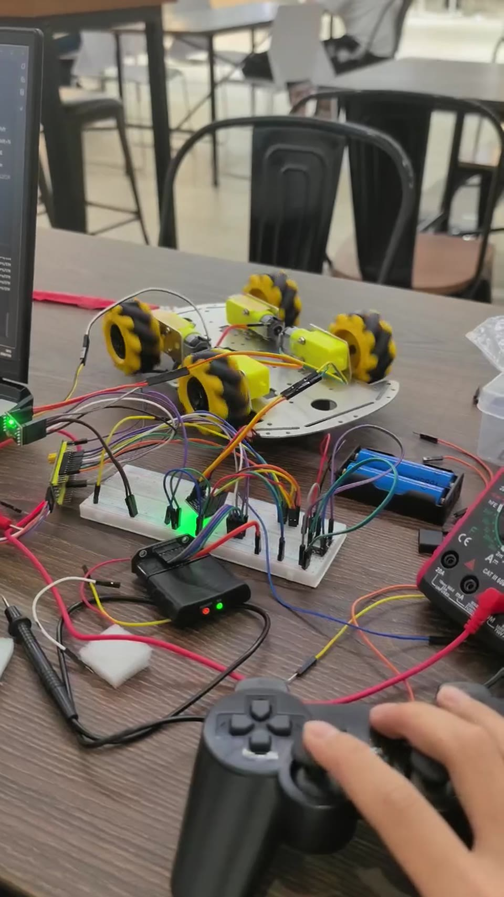

*视频 4-3　手柄控制两组（4 个）电机同时转动（对应「电机运动（全部）」）（完整视频：手柄控制电机旋转（两组）.mp4）*

### 4.4 问题与解决

本阶段电机驱动部分未见硬件级故障；调试中主要问题是「轮子转向不对」，最终定位为**麦轮安装朝向**而非电机驱动代码（见第 5 节）。

### 4.5 当前状态与待办

- 已具备 4 电机正反转与调速能力。
- 已提供：4 个电机同时转动的演示见 4.3 视频 4-3。
- 待评估：DRV8833 电流裕量与散热，必要时调整驱动方案。

---

## 5. 麦克纳姆轮运动学解算与底盘运动控制（10.8～10.9）

### 5.1 功能描述

将手柄的摇杆输入映射为车体三自由度速度（前后 vx、左右 vy、旋转 wz），再通过麦克纳姆逆解分解为四个轮子的目标转速，实现全向移动。对应考核指标：**底盘运动（单一 / 全部）**。

### 5.2 设计思路与选型

**坐标系约定**（车体坐标系）：

- x 轴：车头方向为正（前进）
- y 轴：车体左侧为正（左移）
- z 轴：垂直地面向上，**逆时针旋转为正**（即左转为正）

**轮序约定**：1 = 左前、2 = 右前、3 = 右后、4 = 左后。

**逆解推导思路**：三种运动线性叠加。

- 前后运动 vx：四个轮子同向贡献 +vx；
- 左右运动 vy：需要左前/右后与右前/左后两组反向，形成横向合力；
- 旋转运动 wz：左侧两轮与右侧两轮反向，形成绕中心的力偶。

以左前轮为例：前后贡献 +vx；左右平移时它需要反向，贡献 −vy；逆时针自转时它向后，贡献 −wz。三者叠加即 `speed[0] = vx − vy − wz`。其余轮子按位置调整符号即可。

**逆解公式**：

```c
speed[0] = vx - vy - wz;   // 左前 FL
speed[1] = vx + vy + wz;   // 右前 FR
speed[2] = vx - vy + wz;   // 右后 RR
speed[3] = vx + vy - wz;   // 左后 RL
```

**符号规律**：

| 轮子 | vx 项 | vy 项 | wz 项 |
| --- | --- | --- | --- |
| 左前 | + | − | − |
| 右前 | + | + | + |
| 右后 | + | − | + |
| 左后 | + | + | − |

**代码实现**：

```c
void Mecanum_SetVelocity(int vx, int vy, int wz) {
    int speed[4];
    speed[0] = vx - vy - wz;   // 左前
    speed[1] = vx + vy + wz;   // 右前
    speed[2] = vx - vy + wz;   // 右后
    speed[3] = vx + vy - wz;   // 左后

    for (int i = 0; i < 4; i++) {
        Motor_SetSpeed(i + 1, speed[i]);
    }
}
```

**与手柄的映射**：

```c
PS2_Read();
int vx = ps2.joy_left_y  * 8;   // 左摇杆 Y → 前后
int vy = ps2.joy_left_x  * 8;   // 左摇杆 X → 左右
int wz = ps2.joy_right_x * 8;   // 右摇杆 X → 旋转
Mecanum_SetVelocity(vx, vy, wz);
HAL_Delay(20);                  // 主循环 ~50Hz
```

> 说明：系数 `*8` 是结合摇杆量程（−128~127）与 PWM 量程（±1000）取的经验比例，仍有约 3 倍的余量空间，后续需按实车手感标定。

### 5.3 开发历程

- **10.8**：底盘调试中，尽管经过多轮代码调试，麦轮的转向仍无法满足「前后左右平移」的标准。
- 决策：**果断停止在代码层面找原因，转而在硬件安装上排查**。
- 结果：发现麦轮安装朝向错误（见 1.4），修正为 X 形对置后，平移功能恢复正常。
（请点击此处查看照片）
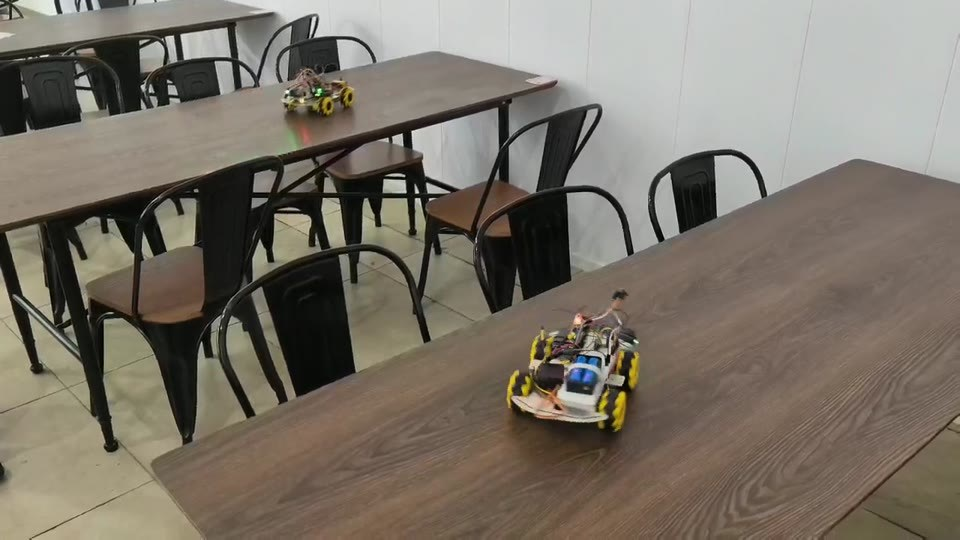

*视频 5-1　底盘前进 / 后退 / 左右平移实车演示（对应「底盘运动（单一）」）（完整视频：实现小车自由移动.mp4）*
（请点击此处查看照片）
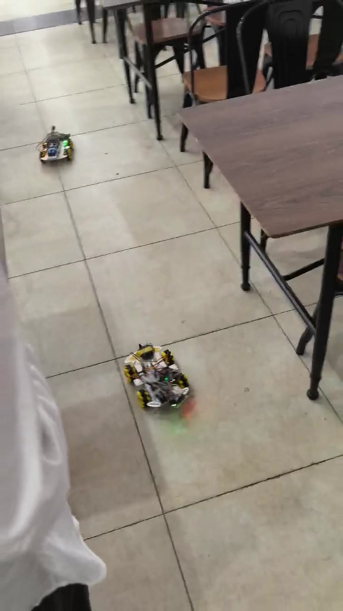

*视频 5-2　底盘全向移动与原地旋转演示（对应「底盘运动（全部）」）（完整视频：实现小车自由移动（2）.mp4）*

### 5.4 问题与解决

**问题：平移方向不正确，反复改代码无效。**

原因：属于机械装配问题（麦轮辊子朝向），与运动学代码无关。

解决：按 X 形对置重新安装麦轮。

**经验教训**：全向底盘的「方向不对」，应按「机械朝向 → 电机接线 → 代码符号」的顺序排查，先排除机械问题再动算法，可显著节省时间。

### 5.5 方向验证表（设计预期）

按上述逆解公式，各界定输入下四个轮子的转向预期为（「前」表示该轮正转）：

| 操作 | 左前 | 右前 | 右后 | 左后 | 底盘运动 |
| --- | --- | --- | --- | --- | --- |
| 左摇杆前推（vx > 0） | 前 | 前 | 前 | 前 | 前进 |
| 左摇杆左推（vy > 0） | 后 | 前 | 后 | 前 | 左移（对角模式） |
| 右摇杆左推（wz > 0） | 后 | 前 | 前 | 后 | 左转（左右模式） |

> 上表由逆解公式直接推导得到，用于烧录后的首轮自检；实车调试应以实际转向为准，若某个轮子方向不符，应**整体**修正该轮（交换电机两根输出线，或对该轮速度整体取反），而**不是**只改公式中的某一项符号。

### 5.6 当前状态与待办

- 平移功能：修正麦轮朝向后已恢复。
- 已提供：前进 / 左右 / 原地旋转的实车演示见 5.3 视频 5-1、5-2。
- 待完善：`vx/vy/wz` 的量纲归一化（当前用统一经验系数，严格实现应按轮半径与轮距/轴距拆分成不同增益）。

---

## 6. 舵机控制（携带机构）（10.15～10.18）

### 6.1 功能描述

为后续的携带机构（夹爪/托举）提供舵机驱动能力。对应考核指标：**舵机运动（单一）**与**舵机运动（多项）**。

### 6.2 设计思路与选型

- 舵机选用官方物资表中的 **MG995（180°，铁齿铜牙）** 与 **SG90（180°）**。
- 舵机由 5V 电源供电，并在电源端并联 **2200μF 电解电容** 做储能，避免多舵机同时动作时拉低母线电压导致主控复位。

**舵机 PWM 参数（典型值，待实测定标）**：

| 参数 | 值 |
| --- | --- |
| 周期 | 20ms（50Hz） |
| 脉宽范围 | 0.5ms（0°）~ 2.5ms（180°） |
| 中位脉宽 | 1.5ms（90°） |

### 6.3 开发历程

- **10.9**：在电源端加装 2200μF 电解电容后，舵机转动时的电压电流趋于稳定。
（请点击此处查看照片）
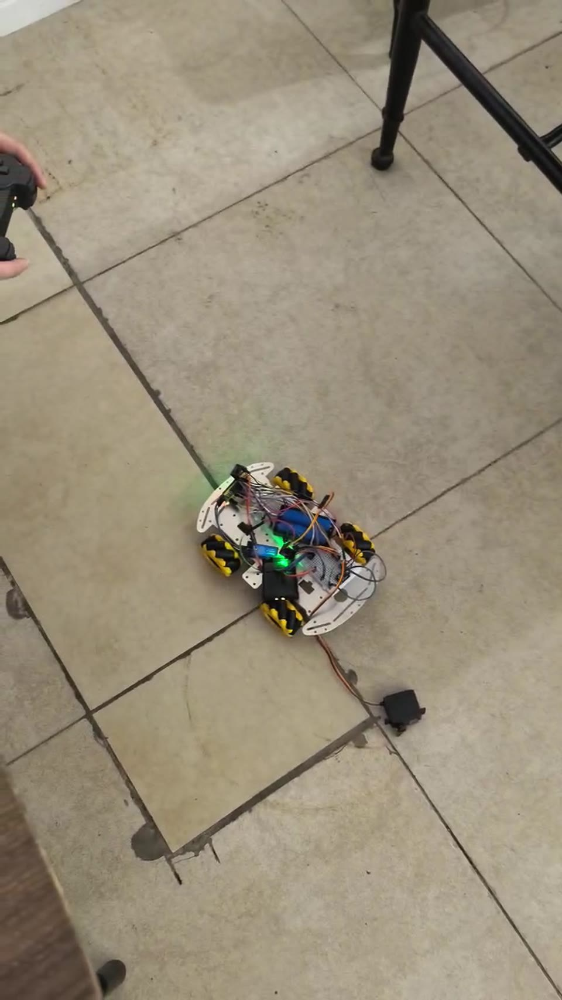

*视频 6-1　加装舵机后的底盘平移（对应「舵机运动（单一）」）（完整视频：加上舵机之后的小车平移.mp4）*

### 6.4 问题与解决

**问题：舵机动作时电压波动。**

现象：舵机启动/堵转瞬间，母线电压出现明显跌落。

解决：在电源端并联 2200μF 电解电容，储能并吸收冲击电流，供电趋于稳定。

### 6.5 当前状态与待办

- 供电稳定性：已通过电容改善。
- 已提供：加装舵机后的平移演示见 6.3 视频 6-1；舵机 PWM 通道分配与角度控制代码待补充。
- **方块收集（携带）机构：进行中。** 夹爪与收集动作尚在设计调试，中期阶段仅完成舵机驱动与供电，暂未实现地面方块的自主抓取与保持，后续继续迭代。

---

## 7. 整机联调与结构强度

### 7.1 功能描述

将机械、供电、通信、驱动、运动学各模块联调为可遥控的整车，并满足结构强度与尺寸规范。对应考核指标：**结构稳定性**、**尺寸规范**。

### 7.2 调试顺序（自检清单）

1. 工具链与烧录正常（ST-Link + CLion / CubeProgrammer）；
2. 单个电机能正反转；
3. 4个电机都能正常转动；
4. PS2 手柄通信正常（按键 + 摇杆）；
5. 整车可用手柄遥控移动；
6. 麦轮方向正确，能前后、左右、原地旋转。

### 7.3 开发历程

- **10.6–10.7**：完成机械装配与电控接线。
- **10.8**：麦轮方向修正；并行装配第二台小车。
- **10.9–10.11**：参加机械、电控、硬件培训，将所学应用到整车调试（见第 8 节收获记录）。
- **10.12**：推进洞洞板/PCB 走线改造。
（请点击此处查看照片）
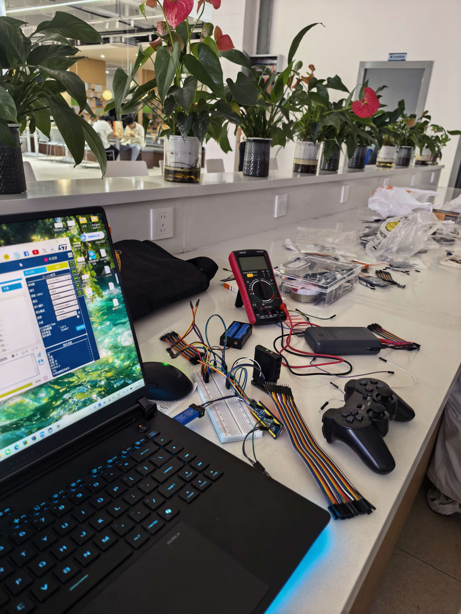

*图 5　调试与烧录：STM32CubeProgrammer + ST-Link 现场烧录*
（请点击此处查看照片）
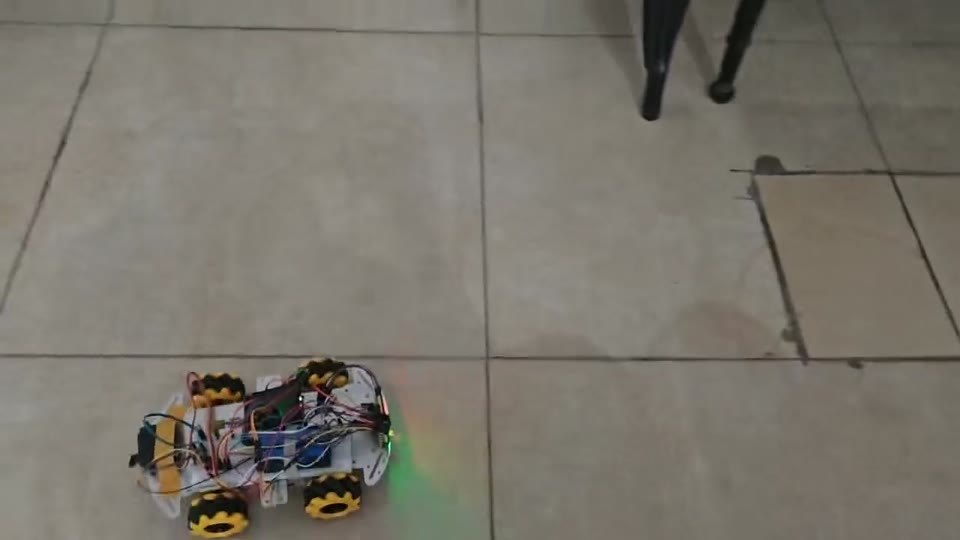

*视频 7-1　整机功能完整演示（不含机械臂）：外形展示 + 遥控移动（完整视频：完整功能展示（不含机械臂）.mp4）*

### 7.4 常见问题排查表

| 现象 | 可能原因 | 解决 |
| --- | --- | --- |
| 电机不转 | 电源未接、方向脚错、PWM 未启动 | 检查 VM 电压、方向脚电平、Motor_Init() |
| 电机只往一个方向转 | 方向脚接错 | 检查 DRV8833 的 AIN1/AIN2 |
| PS2 读不到数据 | DI/DO 接反、CS/CLK 时序不对 | 检查接线、放慢软件 SPI |
| 烧录失败 | ST-Link 连接问题、芯片被锁 | 检查 SWD 接线、用 CubeProgrammer 解除读保护 |
| 车不走直线 | 麦轮朝向不对、电机转速不一致 | 检查麦轮朝向、标定 PWM |
| 车原地打转 | 某个轮子方向反了 | 检查该轮接线与代码符号 |

### 7.5 外形展示、尺寸实测与结构强度

#### 外形展示

整机为四轮麦克纳姆轮底盘 + 红色 3D 打印机械臂（装载 MG995 舵机与夹爪），绕车一周展示如下：
（请点击此处查看照片）
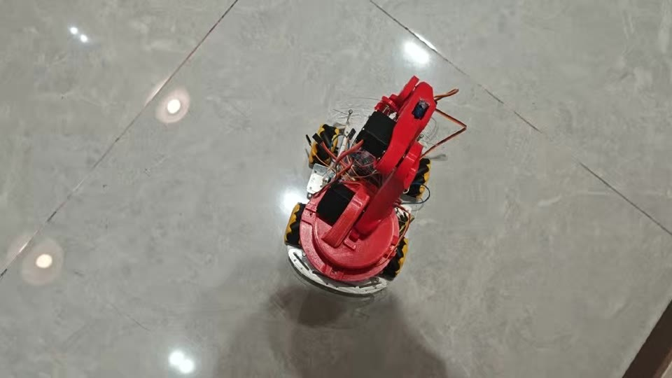

*视频 1-1　整机外形展示（绕车一周）（完整视频：小车外形展示.mp4）*

#### 尺寸实测

按规则要求，用钢尺对「初始状态」与「展开状态」分别测量，测量时**钢尺与车体同时出镜**：

| 测量项 | 实测值 | 规则上限 | 结论 |
| --- | --- | --- | --- |
| 初始长度 | **280 mm** | ≤ 290mm | 符合（余 10mm） |
| 初始宽度 | **170 mm** | ≤ 195mm | 符合（余 25mm） |
| 初始高度 | **205 mm** | ≤ 210mm | 符合（余 5mm） |
| 展开长度（机械臂展开） | **391 mm** | ≤ 445mm | 符合（余 54mm） |

> 四项尺寸均在规则限值之内。需要留意的是**高度 205mm 距上限 210mm 仅剩 5mm 余量**，后续加装方块收集机构或增加舵机层数时，需优先控制高度，避免超出初始尺寸限制。

四张测量照片（钢尺贴靠车体，可直接读数）：
（请点击此处查看照片）
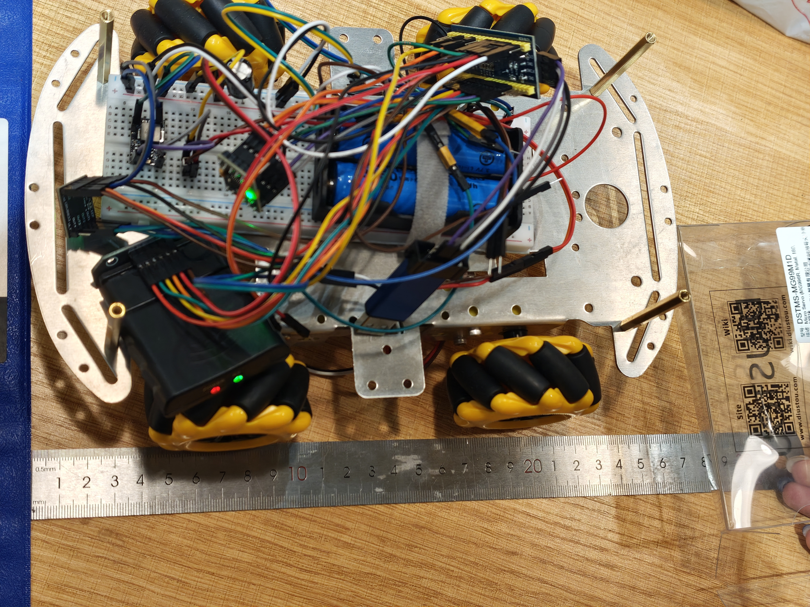

*图 6　初始长度测量：钢尺沿车体长边放置*
（请点击此处查看照片）
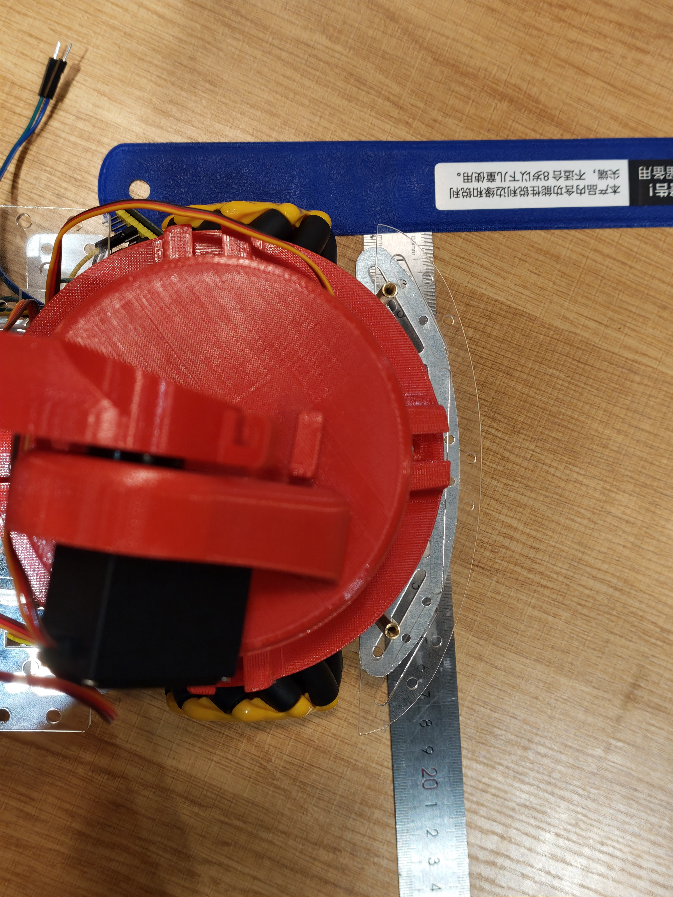

*图 7　初始宽度测量：钢尺横跨车体两侧*
（请点击此处查看照片）
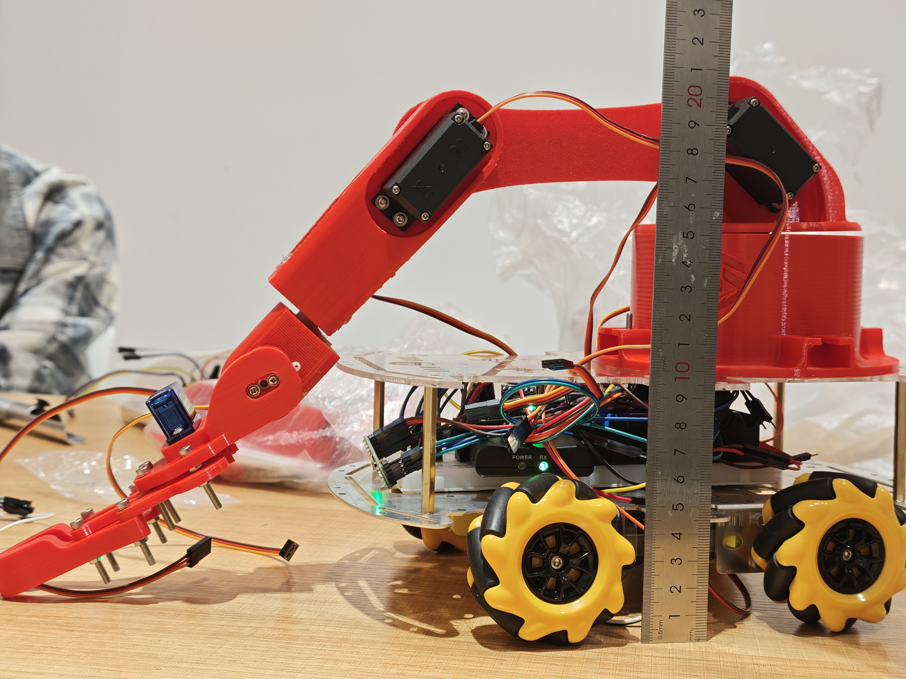

*图 8　初始高度测量：钢尺竖直贴靠车体侧面*
（请点击此处查看照片）
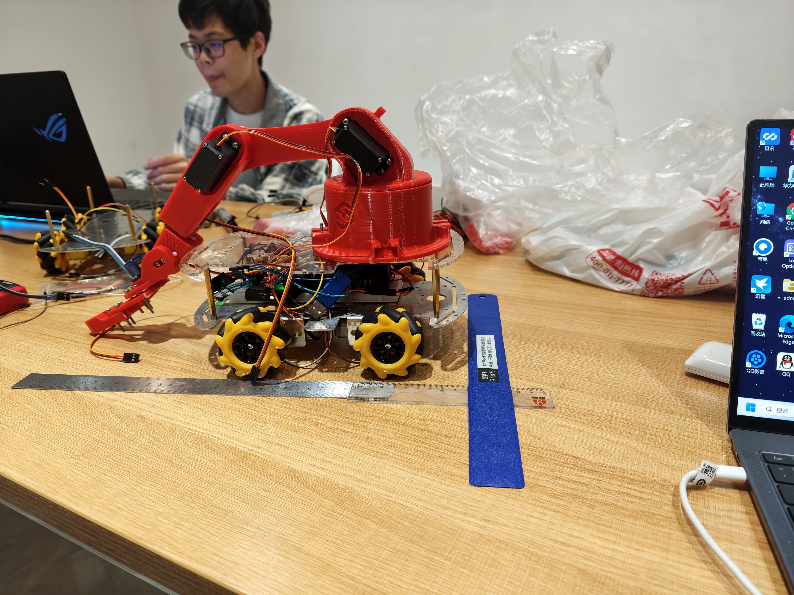

*图 9　展开长度测量：机械臂展开至最大行程*

#### 结构稳定性（180mm 自由落体）

规则要求：机器人从 **180mm 高度、以底面朝下的初始姿态自由下落，无零件掉出**即为合格。

本队按上述方法实测：从 180mm 高度自由释放，落地后车体结构完整、**无零件脱落**，底盘、轮系与主控供电均正常。
（请点击此处查看照片）
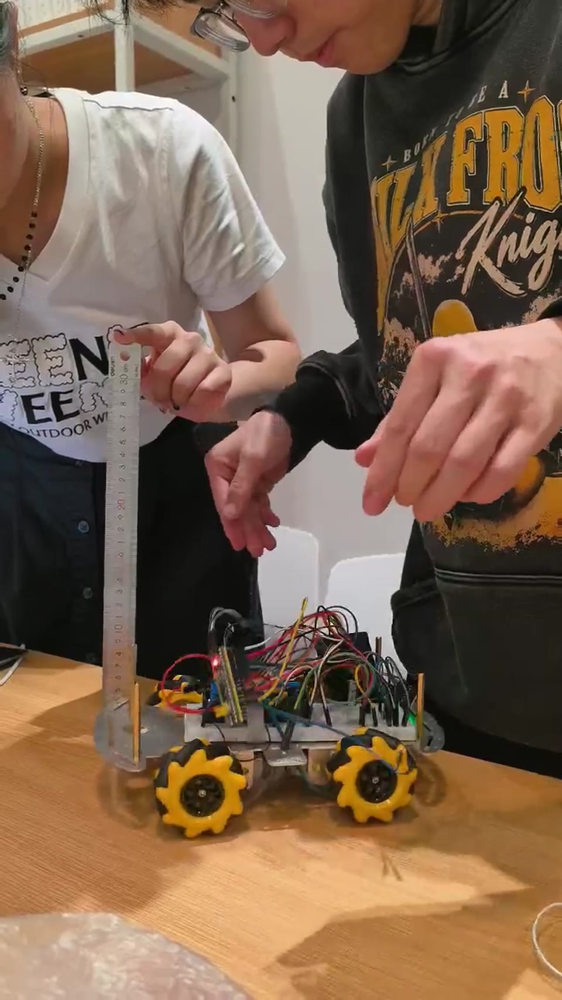

*视频 7-2　180mm 自由落体测试（完整视频：小车坠落测试.mp4）*

### 7.6 安全注意事项

1. 调试电机时先把车架空，避免突然转动伤人；
2. 接线前先断电，接好后再上电；
3. 电池不可短路、不可反接；
4. 烧录时注意 ST-Link 的 3.3V 不要接错；
5. 上电前核对电源极性（本项目已因反接烧毁过 1 个 DC-DC 模块）。

---

## 8. 培训收获与知识沉淀

**10.9 – 10.11 培训主要收获**：

1. 认识了 STM32CubeMX 中核心板构成、系统（SYS）与时钟树（CLK）的结构，理解 HSE 与 HCLK 的配置关系；
2. 掌握了 PWM 的信号传输原理，理解如何通过调整占空比控制信号强度与输出频率；
3. 从学长处获得物资获取渠道的经验（除电商外，还有 GitHub、嘉立创等开源平台），并据此完善了选型思路；
4. 学习元器件基础知识，并据此在电源端加入 2200μF 电解电容，改善了舵机供电稳定性。

**沉淀出的工程规范**：

- 上电前先核对接线极性（源于 DC-DC 烧毁事故）；
- 全向底盘方向异常先查机械朝向（源于麦轮装反事故）；
- 通信不通先放慢时序再逐步收紧（源于 PS2 通信事故）；
- 走线由面包板/杜邦线迁移到洞洞板/PCB（符合规则建议）。

---

## 9. 物资选型与成本核算

### 9.1 核心器件选型

| 器件 | 型号 | 数量 | 选型理由 |
| --- | --- | --- | --- |
| 主控 | STM32F103C8T6 核心板 | 2 | 官方物资表指定，资源满足需求 |
| 舵机 | MG995 / SG90 | 2 / 4 | 官方物资表指定，扭矩/体积互补 |
| 遥控 | PS2 无线手柄（锁定款）+ 直插转接板 | 2 | 规则指定遥控器 |
| 电机 | TT 马达（单轴 1:48） | 8 | 官方物资表指定 |
| 轮系 | 60mm 黄色麦轮（含联轴器） | 2 套 | 全向移动 |
| 底盘 | 4 轮金属折弯底盘 | 2 | 官方物资表指定 |
| 驱动 | DRV8833 电机驱动模块 | 4 | 双 H 桥，性价比高 |
| 降压 | Mini DC-DC 5V | 2 | 供电分配 |
| 调试 | ST-Link V2 | 1 | 烧录与调试 |
| 电源 | 18650 电池盒（2 节）+ 充电器 | 2 / 1 | 7.4V 供电 |
（请点击此处查看照片）
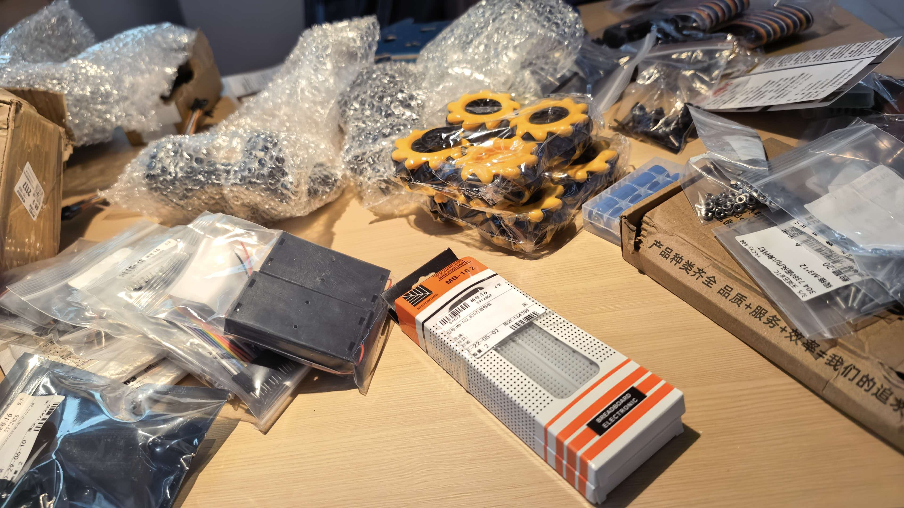

*图 10　按官方物资表采购的物资：麦轮套装、MG995 舵机、电池盒、紧固件等（对应「规划 / 现有采购单」）*

## 10. 中期考核完成度自评

| 序号 | 基础功能指标 | 当前状态 | 材料情况 |
| --- | --- | --- | --- |
| 1 | 外形展示（含能量单元的完整机体，绕车一周） | 已实现 | 视频 1-1、7-1 |
| 2 | 电机运动（单一） | 已实现 | 视频 4-1、4-2 |
| 3 | 电机运动（全部，≥4 个） | 已实现 | 视频 4-3 |
| 4 | 舵机运动（单一） | 进行中 | 视频 6-1（加装舵机后的平移） |
| 5 | 舵机运动（多项，≥3 个） | 未开始 | — |
| 6 | 底盘运动（单一，PS2 遥控） | 已实现 | 视频 5-1、3-1（车体与手柄同框） |
| 7 | 底盘运动（全部） | 已实现 | 视频 5-2、7-1 |
| 8 | 尺寸规范 | 已实测 | 图 6–9（钢尺测量照片） |
| 9 | 方块携带（单一） | 进行中 | — |
| 10 | 方块携带（多项） | 进行中 | — |
| 11 | 结构稳定性（180mm 自由落体） | 已测试 | 视频 7-2 |
| 12 | 规划 / 现有采购单 | 已完成（见第 9 节） | 本文档第 9 节 |

**后续计划（截至 10 月 19 日）**：

1. 完成舵机控制与携带机构的设计与验证，力争实现「舵机运动（单一）」；
2. 补齐剩余演示材料（方块携带），其余材料（外形、电机、底盘、尺寸、结构强度）已补拍完成；
3. 补充重量实测数据，确认 ≤ 2.0kg；
4. 统计实际采购发票，完成成本核算；
5. 整理代码与文档，上传至仓库 `docs/` 目录并提交。

---

## 11. 项目日志（按时间顺序）

### 2026-10-06

- 小组集合，拆封快递，清点零件齐全度，开始底盘初步拼装。
- 问题 1：底盘附赠螺丝数量不足，自购螺丝长度不够，轮座无法与底盘固定。
- 问题 2：对比赛中采用面包板还是 PCB 产生疑问。
- 解决 1：本地未找到合适型号，由组员协助从外地带回，国庆假期结束时到货。
- 解决 2：（当时未定）后续结论：按规则建议采用集成电路板/洞洞板，减少杜邦线脱落风险。

### 2026-10-07

- 完成底盘拼装，转入电控部分，遇到较大阻碍。
- 问题 1：接线错误导致正负极接反，1 个 DC-DC 降压模块烧毁（改正后再未发生）。
- 问题 2：PS2 手柄无法与接收器配对；配对后信号仍无法传递。
- 解决 1：经商家提示，长按接收板背面的按键解除锁定，配对成功。
- 解决 2：经学长提示，陆续烧录了多个 PS2 启动文件，效果待验证。

### 2026-10-08

- 烧录商家提供的 `.hex` 文件，确认无效。
- 查阅资料后判断为主机轮询接收器频率过高，放慢节奏后手柄与接收器通信畅通。
- 问题：多轮代码调试后，底盘麦轮转向仍不满足前后左右平移标准。
- 解决：停止在代码层面排查，改从硬件安装入手；发现麦轮安装朝向错误（未注意车头方向与安装方法），调整后问题解决。
- 并行推进第二台小车的电线连接，有了经验后 PS2 手柄连接异常顺利。

### 2026-10-09 ~ 2026-10-11

- 参加机械、电控、硬件培训，主要收获：

1. 认识 STM32CubeMX 的核心板构成与 SYS、时钟树结构；
2. 理解 PWM 传输原理与占空比、频率的调节方法；
3. 从学长处获得物资获取渠道经验（GitHub、嘉立创等开源平台）；
4. 学习元器件基础知识，并在面包板上加装 2200μF 电解电容，实现舵机转动时的电压电流稳定。

### 2026-10-12

- 尝试以洞洞板（万用板）替代面包板，该方案仍在推进中。

---

## 附录 A：引脚分配总表

| 引脚 | 功能 | 外设 |
| --- | --- | --- |
| PA0 | 电机 1 PWM | TIM2_CH1 |
| PA1 | 电机 2 PWM | TIM2_CH2 |
| PA2 | 电机 3 PWM | TIM2_CH3 |
| PA3 | 电机 4 PWM | TIM2_CH4 |
| PA4 | PS2_CS | GPIO 输出 |
| PA5 | PS2_CLK | GPIO 输出 |
| PA6 | PS2_DI | GPIO 输出 |
| PA7 | PS2_DO | GPIO 输入（浮空） |
| PA13 | SWDIO | 调试接口 |
| PA14 | SWCLK | 调试接口 |
| PB0 | 电机 1 方向 | GPIO 输出 |
| PB1 | 电机 2 方向 | GPIO 输出 |
| PB2 | 电机 3 方向 | GPIO 输出 |
| PB5 | 电机 4 方向 | GPIO 输出 |

## 附录 B：工程目录结构

```
Core/
├── Src/
│   ├── main.c        # 初始化 + 主循环
│   ├── motor.c       # 电机驱动：PWM + 方向
│   ├── ps2.c         # PS2 手柄通信：软件 SPI
│   ├── mecanum.c     # 麦轮运动学逆解
│   ├── gpio.c        # GPIO 初始化（CubeMX 生成）
│   └── tim.c         # 定时器初始化（CubeMX 生成）
└── Inc/
    ├── motor.h
    ├── ps2.h
    └── mecanum.h
```

| 模块 | 职责 | 对外接口 |
| --- | --- | --- |
| motor | 控制电机转速与方向 | Motor_Init()、Motor_SetSpeed() |
| ps2 | 读取手柄数据 | PS2_Init()、PS2_Read() |
| mecanum | 将车体速度分解为轮速 | Mecanum_SetVelocity() |
| main | 初始化与主循环调度 | — |

## 附录 C：开发工具链

| 工具 | 作用 |
| --- | --- |
| STM32CubeMX | 图形化配置引脚、时钟、外设，生成初始化代码 |
| CLion | 代码编写、编译、调试 |
| STM32CubeCLT | 提供 ARM GCC 工具链、CMake、Ninja |
| STM32CubeProgrammer | 烧录程序 |
| STM32CubeMonitor | 运行时实时监控变量 |

## 附录 D：后续扩展方向

- **FreeRTOS**：将 PS2 读取、麦轮解算、电机控制拆分为独立任务；
- **PID 闭环**：加装编码器测速，实现速度闭环；
- **姿态解算**：加装 IMU，实现云台/姿态稳定；
- **自动控制**：加装传感器或视觉，实现道具自动收集（全自动/半自动机器人）。
